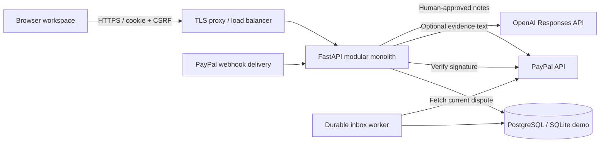
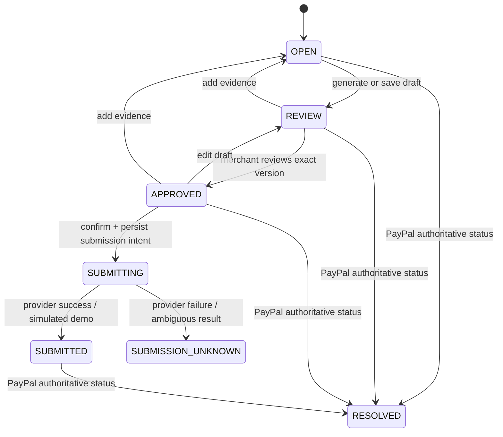

# Current deployment architecture

The frontend and backend are now independent deployment projects. See [DEPLOYMENT.md](DEPLOYMENT.md) for the current topology and auth transport. The static UI moved from static/ into frontend/public/. FastAPI no longer serves UI assets. The browser uses its frontend origin for /api/v1, which Vercel rewrites to Render/Railway; locally a streaming Node proxy provides the same route. SameSite=Strict cookies, CSRF, tenant isolation, review, evidence, audit and submission safeguards remain. The backend stays at the repository root in app/.

The original product/data-model architecture below remains useful; references to one combined static/API deployment or static/ source paths are superseded by this update.

# Architecture: minimal now, explicit growth path

## Product boundary

PayGuard helps a merchant respond to disputes; it does not decide whether a customer is truthful, guarantee recovery, or determine Seller Protection eligibility. The MVP supports five currencies with two decimal places (USD, EUR, GBP, CAD, AUD). Amounts are integer minor units; totals are grouped by currency rather than summed across currencies.

The PDF supplies the product concept and proposed stack. Its embedded agent prompts are source material, not instructions to the build agent. The implementation preserves ingestion → evidence → draft → review → submission, with the following deliberate scope reductions:

| Proposed in brief | Minimal implementation | Reason |
|---|---|---|
| Next.js + FastAPI microservices | FastAPI + same-origin browser ES module | One deploy, no frontend build or CORS, fewer failure modes |
| AG Grid Enterprise | Accessible native table with search, status filters and pagination | No commercial license required |
| LangChain / LlamaIndex | Small injectable Responses API adapter | No retrieval or orchestration framework needed for bounded evidence |
| Multiple carrier APIs + image OCR | Manual evidence and text-PDF extraction | Honest demo without unavailable credentials or heavy OCR runtime |
| Autonomous submissions by confidence | Explicit human approval on a versioned draft | Model confidence is not proof of factual accuracy |
| PostgreSQL everywhere | SQLite demo; PostgreSQL deployment profile | Immediate local startup with shared database path available |

## System topology



The API serves static UI and JSON under one origin. Authentication uses a random opaque session cookie; only its SHA-256 hash is stored. Sessions expire after 8 hours. Mutations require the session CSRF token; supplied Origin must match APP_ORIGIN. Passwords use scrypt with random salts. All dispute/evidence/submission/audit reads are scoped by the authenticated tenant, with unknown resources returning 404.

The webhook endpoint verifies the original JSON with PayPal, stores a deduplicated durable inbox record, and responds 202. The worker claims a record using a conditional update, uses a 120-second lease, fetches current provider state, and updates the dispute and audit in one transaction. Five failed attempts enter DEAD state. Exponential backoff and expired lease recovery make ingestion at least once. Provider timestamps and optimistic versions prevent older snapshots and concurrent merchant edits from silently overwriting newer data.

Drafting is synchronous and bounded (45-second provider timeout, 20 evidence items, 24000 evidence characters per case, 10 draft calls/minute/tenant). It happens outside a database write transaction. The update succeeds only if the case version is still current. This is acceptable for the hackathon. Move drafting to a job/outbox worker before high throughput or long OCR tasks.

## Case state machine



All mutations carry a `version`. A conditional SQL update increments the version or returns 409. Adding evidence clears the old draft and approval. Editing a draft requires a new review. Submitted, unresolved pending, and resolved cases reject edits.

Submission persists PENDING intent and locks the dispute BEFORE the external call. There are unique constraints on `(tenant_id, request_key)` and `(dispute_id, draft_version)`. Reusing the key for the same request returns the stored outcome. Reusing it for a different request is 409. Any uncertain provider result becomes UNKNOWN and is never automatically resent. A crash after the provider call but before the local result commit leaves PENDING/SUBMITTING for operator reconciliation. This provides local duplicate prevention, not distributed exactly-once delivery.

## Relational schema

See `schema.sql` for actual PostgreSQL DDL generated from the models.

| Table | Important columns and constraints | Purpose |
|---|---|---|
| tenants | UUID PK, name | Workspace boundary |
| users | UUID PK, tenant FK, email unique, password_hash | One owner/member identity per account |
| sessions | token_hash PK, user FK, csrf, expires indexed | Revocable server sessions |
| disputes | UUID PK, tenant FK, paypal_id, reason, amount_cents, currency, status, due_at, draft, source, version | Merchant queue and current draft |
| evidence | UUID PK, dispute FK, tenant FK, title, kind, content, sha256 | Extracted source text and merchant records |
| audit | UUID PK, tenant FK, actor, action, resource_id, created_at | Application append-only activity |
| webhook_inbox | UUID PK, tenant FK, event_id, payload, state, attempts, available_at | Durable intake queue |
| submissions | UUID PK, tenant FK, dispute FK, request_key, draft_version, state, provider_reference | Durable external-write intent |
| rate_buckets | hashed key PK, count, expires | Shared fixed-window auth and draft throttling |

Composite queue index `(tenant_id, status, due_at, id)`, provider ID uniqueness per tenant, and expiry indexes support hot paths. Every evidence query checks tenant and dispute. The current schema does not enforce tenant equality across FKs through composite keys; use database RLS/composite FKs as defense in depth when adding administrative writers. Audit immutability is enforced by application behavior, not database permissions or WORM storage.

## API contract

All paths below are prefixed with `/api/v1`. API docs and exported OpenAPI include request/response details. Protected browser mutations need `X-CSRF-Token`; submit also requires `Idempotency-Key`.

| Method | Path | Purpose |
|---|---|---|
| GET | /config | Public mode, no secrets |
| POST | /auth/register | New workspace and owner |
| POST | /auth/login | Password login |
| POST | /auth/demo | Isolated synthetic workspace (demo only) |
| GET | /auth/me | Session identity and CSRF token |
| POST | /auth/logout | Revoke current session |
| GET | /overview | Counts and amounts grouped by status/currency |
| GET | /disputes?q=&status=&page=1&limit=25 | Tenant queue, max 100/page |
| POST | /disputes | Add manual case, integer amount, exact deadline |
| GET | /disputes/{id} | Case plus evidence |
| POST | /disputes/{id}/evidence | Add bounded merchant text; invalidate prior draft |
| POST | /disputes/{id}/upload | Multipart text-PDF extraction, max 5 MB/20 pages |
| POST | /disputes/{id}/draft | Template or provider drafting |
| PUT | /disputes/{id}/draft | Save merchant edits |
| POST | /disputes/{id}/approve | Explicit reviewed=true on current version |
| POST | /disputes/{id}/submit | Explicit confirmed=true and unique request key |
| GET | /submissions | Latest 100 submission records |
| GET | /audit?page=1 | 50 activity events/page |
| GET | /integrations | Boolean server configuration, no secret values |
| POST | /webhooks/paypal | Verified external intake, no browser cookie required |

`/health/live` checks process health. `/health/ready` checks that schema/database are reachable. Errors use HTTP codes and a `detail`; unexpected failures include a request ID and generic message. No stack trace is sent to the browser.

## UI architecture

One static document with ES module `static/app.js`. Module state stores current identity/CSRF (in memory), view, search/filter/page, selected case and version. Data remains on the server; no browser local storage of customer records or session tokens. Native dialogs provide keyboard focus trapping and Escape close. All server text is escaped before HTML interpolation; textarea content is escaped too. CSP permits only same-origin code/styles and disallows inline scripts.

Screens: sign-in/register/demo → dispute inbox (summary, filters, deadline ordering, paginated table) → case drawer (evidence, PDF text import, editable defense, explicit review and submit). Activity and integration views are separate navigation choices. Busy buttons prevent rapid duplicate clicks. Stale mutations surface 409 so merchants refresh and review. Search responses are sequenced so an older response cannot replace a newer query.

The visual direction uses forest green, warm neutral backgrounds, compact operational typography and restrained status colors. Responsive layout collapses the sidebar to top navigation; the table scrolls horizontally on small screens. Status text accompanies color.

## File structure

```text
payguard/
  app/
    config.py       environment validation
    models.py       schema and database connections
    security.py     password/session hashing
    schemas.py      strict input validation
    service.py      tenant queries and optimistic transitions
    providers.py    PayPal and optional OpenAI adapters
    main.py         auth, API, middleware and static delivery
    worker.py       durable inbox processing and retry loop
    manage.py       explicit initial schema and workspace lookup
  static/           responsive HTML/CSS and browser ES module
  tests/            HTTP workflows, security, providers, workers, PostgreSQL smoke
  docs/             architecture, schema, OpenAPI, operations, verification
  .github/workflows/ci.yml
  requirements.in   human-readable dependency inputs
  requirements.txt  exact tested dependency versions
  .env.example
  Dockerfile
  compose.yaml
  pytest.ini
  README.md
```

## Path to millions of users

Millions of registered users and millions of concurrent requests are different capacity targets. No scale claim is made without a workload and measurements.

1. **Initial launch:** managed PostgreSQL, TLS proxy, one API deployment plus inbox worker, backups with restore drills, provider sandbox validation, monitoring of p95 latency/error rate/inbox age/dead letters/pending submissions. Add identity recovery and verified accounts before public signup.
2. **Growing traffic:** horizontally replicate stateless API processes; shared sessions/rate state remain in PostgreSQL. Put static files behind a CDN. Use keyset pagination and a dedicated search strategy as tenant queues grow. Bound connection pools against DB capacity. Move expensive PDF parsing into resource-limited workers and retain originals in private object storage with short-lived links, malware scanning and retention policies.
3. **High throughput:** queue AI/evidence/submission work through transactional outbox, use dedicated queue consumers, prioritize approaching deadlines, apply per-tenant quotas/backpressure, and centralize rate limiting at the edge/Redis. Move provider credentials into per-tenant encrypted integration records and add merchant onboarding OAuth/partner flows with eligibility checks. The current environment-based single PayPal merchant mapping does not implement this.
4. **Large scale:** PostgreSQL RLS and least-privilege roles, read replicas, partition event/audit histories, tenant-based sharding only after measurements, region and residency strategy, DR recovery objectives, tracing and immutable audit export. Validate capacity with representative cardinality and load, fault injection, and concurrency tests on deployed infrastructure.

The modular monolith keeps boundaries ready for extraction without paying the operational cost of microservices on hackathon day.
