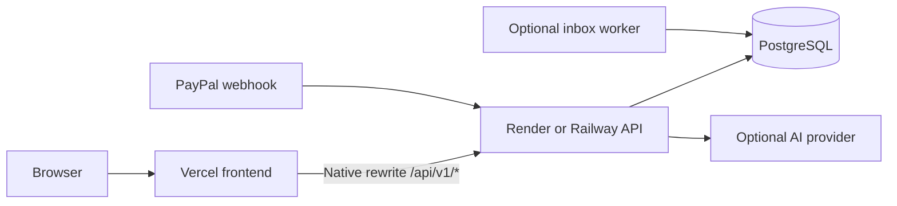

# Separate frontend and backend deployments

Deploy the same repository as two independently updated projects:

| Project | Source / root | Runtime |
|---|---|---|
| Frontend | `frontend/` | Static HTML/CSS/JavaScript on Vercel |
| Backend | Repository root; Python code in `app/` | FastAPI on Render or Railway |
| Database | Managed PostgreSQL | Connected only to backend and optional worker |
| PayPal inbox worker | Same backend source | `python -m app.worker`, when PayPal is enabled |

The frontend retains every current feature: accounts, demo fixtures, searchable dispute inbox, evidence text/PDF upload, drafting/editing, approval, simulated/PayPal submission, audit history and integration status. Carrier verification and image OCR remain outside the existing MVP; this split does not add them.

## How authentication works across two hosts



The browser continues calling `/api/v1` on the frontend domain. Vercel forwards those requests to the separately hosted API, including cookies, CSRF headers, request bodies and Origin. The session cookie has no Domain attribute, so the browser stores it for the frontend host. It stays HttpOnly, SameSite=Strict and Secure in HTTPS deployments. No browser token storage, third-party-cookie dependency, wildcard CORS or direct cross-origin API URL is introduced.

`APP_ORIGIN` on the backend must equal the **frontend** origin exactly (for example `https://your-app.vercel.app`), not the backend URL. The backend verifies this Origin and the session's CSRF token on protected mutations. Set a fixed production frontend URL; preview deployments need a matching backend origin configuration and their own isolated data. Do not allow all origins to make previews work.

Private API responses are marked `Cache-Control: no-store` on both sides. Production Vercel uses an external rewrite, not a Vercel Function that parses or buffers evidence uploads. The local proxy streams file bytes and API responses. Platform request/time limits still apply and must be checked with real hosting before launch.

## 1. Deploy the backend

Connect `Rathorate/payguard-ai` to Render or Railway. Keep the service root at the repository root. For a native Python deployment:

```text
Build: pip install -r requirements.txt
Start: uvicorn app.main:app --host 0.0.0.0 --port $PORT --no-proxy-headers
Health check: /health/ready
Python: 3.12+
```

Alternatively use the root Dockerfile; it contains only the backend and honors `PORT` through `python -m app.serve`. Do not point the Python deployment at `frontend/`.

Set backend environment variables:

```text
DATABASE_URL=<managed PostgreSQL connection URL>
APP_ORIGIN=https://<your-production-frontend-host>
SECURE_COOKIES=true
DEMO_MODE=true
PAYPAL_ENVIRONMENT=sandbox
```

The placeholders are explanatory, not deployable values. Standard `postgres://` and `postgresql://` connection URLs are normalized to the installed psycopg driver. Keep all database and provider secrets on the backend.

For the hackathon demo, `DEMO_MODE=true` initializes missing tables and simulates every submission. When switching to `DEMO_MODE=false`, run `python -m app.manage init-db` once against a fresh database before starting the API, using the provider's one-off/release command capability. This initializes schema, not future migrations. Use versioned migrations before later schema changes. A live-mode backend also requires HTTPS APP_ORIGIN and secure cookies.

After deployment, confirm the backend `/health/ready` returns 200. Its `/` returns service metadata, not the dashboard. `/docs` describes the API; use the frontend for browser login rather than backend Swagger mutations because Origin checking is deliberate.

## 2. Deploy the frontend on Vercel

1. Import the same GitHub repository as a new Vercel project.
2. Set **Root Directory** to `frontend` and framework preset to **Other**.
3. Set `BACKEND_ORIGIN` to the actual backend HTTPS origin, with no `/api` path, credentials, query or fragment.
4. Deploy. `frontend/vercel.ts` reads that variable before the build, generates the API rewrite, and publishes `public/`. Missing or invalid configuration fails the build with an explicit error.
5. Put the resulting production frontend origin in the backend's `APP_ORIGIN` and restart/redeploy the backend as needed.

Only the backend URL belongs in the frontend's hosting configuration. Do not add PayPal secrets, AI keys or DATABASE_URL to Vercel. Updating frontend assets only redeploys the frontend; changing Python logic only requires a backend deployment. Configure project build filters in your hosting dashboards if desired.

## 3. Validate the hosted workflow

Open the Vercel URL, create an interactive demo, search a case, upload a text PDF, generate/edit a draft, approve, simulate submission, inspect the audit log, reload to verify the session, then sign out. Check browser Network requests remain on the Vercel domain under `/api/v1`.

- **502 / backend unavailable:** verify BACKEND_ORIGIN, backend readiness and hosting request limits.
- **403 Untrusted origin:** set backend APP_ORIGIN to the frontend's exact HTTPS origin and use that URL consistently.
- **401 immediately after login:** inspect the Set-Cookie response through the rewrite, HTTPS/Secure settings, and ensure the frontend URL did not change.
- **Data disappears after restarts:** use managed PostgreSQL, not an ephemeral SQLite file.

These cloud checks are required after deployment. Local tests validate the code and proxy contract; they do not certify Vercel/Render/Railway infrastructure.

## Local separate processes

After pulling the update in Ubuntu:

```bash
cd ~/projects/payguard-ai
bash scripts/bootstrap.sh
bash scripts/test.sh
BACKEND_PORT=8001 FRONTEND_PORT=3000 bash scripts/dev.sh
```

Open http://127.0.0.1:3000. The launcher starts two processes, sets the local frontend Origin correctly, and stops both when interrupted. To run each separately, set `APP_ORIGIN=http://127.0.0.1:3000` when starting the backend on port 8001; start the frontend with `BACKEND_ORIGIN=http://127.0.0.1:8001 node frontend/dev-server.mjs`. The local HTTP proxy also supports the private `api` service hostname in Docker Compose.

Node.js 22.18+ is required for the frontend development tools. The UI remains buildless and has no npm runtime dependencies. Backend Python dependencies remain in root `requirements.txt`.

## Official configuration references

- https://vercel.com/docs/project-configuration/vercel-ts
- https://vercel.com/docs/routing/rewrites
- https://render.com/docs/web-services
- https://docs.railway.com/guides/fastapi
